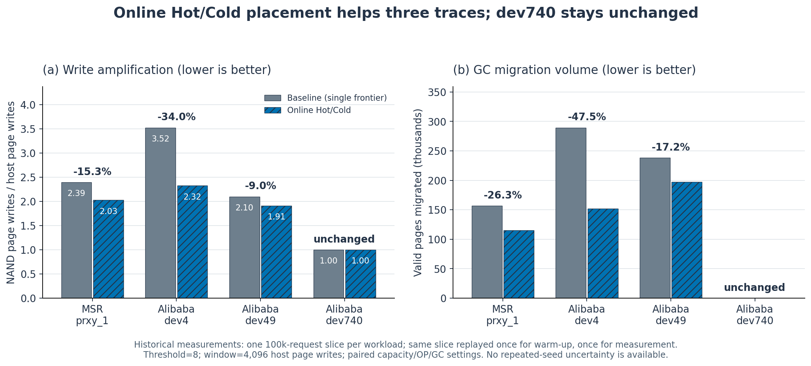

# Online Hot/Cold FTL

Trace-driven placement experiments that identify when recent write history reduces garbage-collection copying.

**Observation:** on one archived Alibaba dev4 100k-request slice, online placement reduced simulator WAF **3.5242 → 2.3249 (−34.03%)** and valid-page migrations **289,432 → 151,909 (−47.51%)**. The dev740 slice was **neutral: WAF 1.0 → 1.0**, with no migration to remove.



*One deterministic replay per policy and slice; warm-up and measurement reuse the same finite 100k requests. Model-level WAF, not real-device latency or endurance. Historical dev4 latency sanity checks fail and latency claims are quarantined.*

[Quick start](#quick-start) · [Methodology](docs/METHODOLOGY.md) · [Results and figures](docs/RESULTS.md) · [Reproducibility](docs/REPRODUCIBILITY.md) · [Limitations](docs/LIMITATIONS.md)

[Executed validation and CI](docs/VALIDATION_STATUS.md)

## Quick start

Python 3.14.6 is the rebuild's tested runtime; the simulator uses only the standard library. Run these commands inside this repository:

```sh
python3 reproduce.py verify
python3 reproduce.py tests
python3 reproduce.py smoke
```

The smoke run is a new, small execution check, not the research result. See [reproducibility](docs/REPRODUCIBILITY.md) for archived Alibaba replay and plot environment setup. Historical result archives are never overwritten.

## Background and research question

Pages with different update frequencies can leave long-lived valid pages inside blocks that otherwise become reclaimable. Does separating recently repeated LPN writes reduce greedy GC migration, and when is there no benefit?

Hypothesis: a sustained hot set with repeated updates should allow block segregation to reduce migration. Four finite trace slices test this mechanism; they do not establish a universal workload law.

## Implementation

A page-mapped FTL maintains mapping/invalidation and a shared free-block pool. Baseline uses greedy victim selection. The proposed policy counts LPN writes in a 4,096-write sliding window, promotes at threshold 8 and writes through separate Hot/Cold frontiers. Both policies retain the same logical/physical capacity, OP definition, GC threshold and victim policy. No future trace is used by the online classifier.

[Architecture and code roles](docs/ARCHITECTURE.md) · [All source files and imports](docs/FILE_MAP.md) · [Configuration](configs/) · [Import provenance](ORIGIN_MANIFEST.json)

## Experimental setup and results

MSR prxy_1 and Alibaba devices 4, 49, 740 each contribute one 100k-request policy slice. A historical 525,559,379-request pilot selected candidate devices; it is not the policy evaluation sample size. Threshold 8 was selected on MSR and carried to the Alibaba slices. Measurement counters are phase deltas after one warm-up pass.

| Workload | Baseline WAF | Hot/Cold WAF | Migration change |
|---|---:|---:|---:|
| MSR prxy_1 | 2.3936 | 2.0269 | −26.31% |
| Alibaba dev4 | 3.5242 | 2.3249 | −47.51% |
| Alibaba dev49 | 2.0992 | 1.9105 | −17.17% |
| Alibaba dev740 | 1.0000 | 1.0000 | 0 pages → 0 pages |

The data include the neutral case. Threshold 2 also worsened historical modeled max latency in MSR; lower WAF does not establish universal latency improvement. [Results](docs/RESULTS.md) links raw archived manifests, derived CSV, script, captions and verification status.


## Future work and related research

Use time-disjoint trace intervals, broader devices, hardware-calibrated models and a separately versioned latency fix. The follow-up [Host Hint Safe Fallback](https://github.com/brightlcy/host-hint-safe-fallback) asks whether lifetime separation can be trusted when hints are imperfect. It inherits the FTL core but uses controlled synthetic inputs and a different evaluation interval.

한국어 요약: 반복 갱신 이력이 있는 일부 trace 구간에서는 분리 배치가 GC 복사를 줄였고, dev740에서는 이득이 없었습니다. 실제 SSD 수명·지연 개선을 증명한 실험은 아닙니다.
