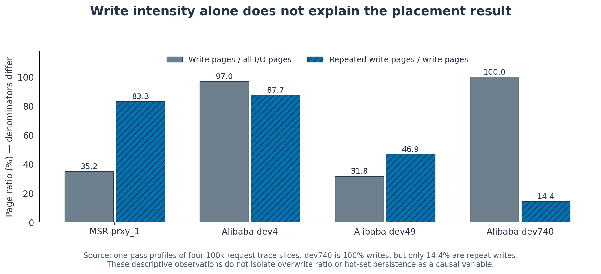

# Figure evidence and regeneration

These figures replot **historical archived measurements**, validated during the October 2026 portfolio rebuild. They are not newly rerun experiments. Existing figures, configurations, traces, and results are preserved.

## Figure plan and claims

| Figure | Claim supported by the data | Evidence |
|---|---|---|
| [Policy comparison, PNG](../figures/rebuild_policy_comparison.png) · [SVG](../figures/rebuild_policy_comparison.svg) | Online Hot/Cold placement lowers measurement-phase WAF and valid-page migration on three selected trace slices, while dev740 is unchanged. | Eight archived policy measurement summaries and manifests; [summary CSV](../data/policy_summary_wide.csv). |
| [Workload characteristics, PNG](../figures/rebuild_workload_characteristics.png) · [SVG](../figures/rebuild_workload_characteristics.svg) | A write-heavy slice can still have few repeat writes: dev740 is 100% writes but has a 14.45% repeat-write page ratio. | Four archived one-pass workload profiles; [profile CSV](../data/workload_characteristics.csv). |

### Figure 1 — Paired policy comparison


**Caption.** Baseline and Online Hot/Cold share each workload's trace, logical/physical capacity, GC configuration, and phase plan. Each 100,000-request slice is replayed once for warm-up and once for measurement; mapping and policy state persist between the phases. Bars use the measurement phase only. The classifier uses a 4,096-host-page-write window and threshold 8. WAF is the ratio of NAND page writes to host page writes; migration is the total number of valid pages copied by GC, shown in thousands. Bar labels give relative policy changes, with the zero-migration case labeled “unchanged” rather than dividing by zero. One deterministic slice is available per workload, so no seed error bars or population-level uncertainty claims are made.

| Workload | Host page writes | Baseline NAND page writes | Hot/Cold NAND page writes | Baseline WAF | Hot/Cold WAF | Valid pages migrated, baseline → Hot/Cold |
|---|---:|---:|---:|---:|---:|---:|
| MSR prxy_1 | 112,413 | 269,071 | 227,855 | 2.393593 | 2.026945 | 156,658 → 115,442 |
| Alibaba dev4 | 114,661 | 404,093 | 266,570 | 3.524241 | 2.324853 | 289,432 → 151,909 |
| Alibaba dev49 | 216,712 | 454,921 | 414,031 | 2.099196 | 1.910513 | 238,209 → 197,319 |
| Alibaba dev740 | 347,400 | 347,400 | 347,400 | 1.000000 | 1.000000 | 0 → 0 |

WAF changes are −15.3179%, −34.0325%, −8.9884%, and 0%; migration changes are −26.3095%, −47.5148%, −17.1656%, and 0%. In this model, every validated measurement satisfies `NAND writes = host writes + valid-page migrations`, so `WAF = 1 + migration / host writes`. This is a measured simulator write-amplification ratio, not “pages moved per GC.” Erases can occur without valid-page migration, as dev740 illustrates.

**Interpretation.** The retained neutral case limits the claim: the policy did not help every selected workload. These four slices do not establish a universal classifier optimum or prove that overwrite ratio alone causes the benefit. No negative WAF case exists in this retained four-workload comparison; none is fabricated.

### Figure 2 — Workload characteristics



**Caption.** One-pass profiles of the same four 100,000-request slices. The gray bars use `write pages / (read pages + write pages)`. The hatched bars use `repeated write pages / write pages`, where a repeat is a page already written earlier in the slice. These are different denominators, explicitly labeled in the graph. These descriptive profiles precede the replayed warm-up/measurement experiment; the profile repeat-write ratio is not a measurement-phase cache-hit rate or a direct lifetime label.

**Interpretation.** Alibaba dev740 is write-only but has relatively little repetition, and the policy makes no hot promotions in its archived summary. Alibaba dev4 has more repeat writes and the largest observed WAF/migration reduction. The selected slices support workload-dependent behavior, not an isolated causal estimate of overwrite ratio or hot-set persistence.

## Evaluation conditions

All runs use 4 KiB pages, 64 pages per block, four simulated chips, target OP 20%, GC threshold 5% of physical pages, a two-block GC reserve, and the same greedy victim selection. Capacity is sized separately to each trace's write working set; the comparison is paired **within** each workload. Actual OP is `(physical pages − logical pages) / physical pages`, following the simulator's convention, and block rounding makes it vary slightly.

| Workload | Logical pages | Physical pages | Actual OP | GC threshold, pages |
|---|---:|---:|---:|---:|
| MSR prxy_1 | 18,804 | 23,552 | 20.1596% | 1,178 |
| Alibaba dev4 | 14,157 | 17,920 | 20.9989% | 896 |
| Alibaba dev49 | 114,981 | 143,872 | 20.0810% | 7,194 |
| Alibaba dev740 | 297,216 | 371,712 | 20.0413% | 18,586 |

The cross-workload bar heights are descriptive results under each workload's own capacity; they are not a controlled comparison of different traces on a single fixed SSD capacity. Every retained Hot/Cold run reports zero `placement_fallback_pages` and zero `mixed_labeled_blocks`.

## Source mapping and checksums

The script reads [results_archive.zip](../results_archive.zip) directly, without extraction. Its archive SHA-256 is:

```text
c10cb3f53a7bc2e4c3d85595c7057a65f53fca64c91bdf167b887750a279cf44
```

| Workload | Policy-result directory inside ZIP | Profile directory inside ZIP |
|---|---|---|
| MSR prxy_1 | `results/prxy_1_hot_cold_threshold_8/` | `results/prxy_1_100k_workload_profile/` |
| Alibaba dev4 | `results/alibaba_compare_device_4_t8/` | `results/alibaba_profile_device_4/` |
| Alibaba dev49 | `results/alibaba_compare_device_49_t8/` | `results/alibaba_profile_device_49/` |
| Alibaba dev740 | `results/alibaba_compare_device_740_t8/` | `results/alibaba_profile_device_740/` |

Each policy-result directory contains `baseline/baseline_summary.csv`, `hot_cold/hot_cold_summary.csv`, each policy's `experiment_manifest.json`, and `comparison_manifest.json`. Profiles use `workload_summary.json`. The Alibaba traces are in `results/alibaba_candidate_100k/`.

[analysis/figure_manifest.json](../analysis/figure_manifest.json) records SHA-256 for every consumed archive member, the archive, the input summary tables, and the generator script. It also records each workload's original trace checksum, simulator version, capacities, measurement counters, and generator environment. The plotting script cross-checks exported CSV values against the archived original summaries and manifests, recomputes WAF/change ratios, validates host/NAND/migration identities, checks paired SSD configurations, and checks the three included Alibaba trace bytes against their original checksums.

The exact MSR 100k trace is **absent from this archive**. Its historical trace checksum is recorded in the archived manifest, but that trace's contents were not reverified by the figure generator. The historical simulator manifests do not contain a source Git commit, so this plotting manifest does not invent one.

## Regeneration

From the project root, source validation needs only Python's standard library:

```sh
python3 analysis/plot_results.py --verify-only
```

Evidence checks raise explicit `ValueError` exceptions and remain active under `python -O` and `PYTHONOPTIMIZE=1`. Regression tests use temporary copies with deliberately damaged numeric summaries, phase plans, and trace bytes; both optimized execution modes must reject those copies. Run these five analysis tests separately from simulator tests:

```sh
python3 -m unittest discover -s analysis -p 'test_plot_validation.py' -v
```

Figure rendering uses a separate CPython **3.12** environment, verified with Python 3.12.14 and Matplotlib 3.9.4. This is distinct from the simulator environment and its `.python-version`.

```sh
python3.12 -m venv .venv-figures
.venv-figures/bin/python -m pip install -r analysis/requirements.txt
.venv-figures/bin/python analysis/plot_results.py
```

The same command writes the two `rebuild_*.png` and two `rebuild_*.svg` files and refreshes `analysis/figure_manifest.json`. It does not run a simulator, change historical results, or overwrite earlier figure names. Plot dependencies are fully pinned in [analysis/requirements.txt](../analysis/requirements.txt); package wheels and font rendering can vary by platform. The numeric source validation is independent of Matplotlib.

## Validation level and limitations

- **Verified here:** eight archived policy summaries/manifests, four workload profiles, summary CSV consistency, simulator WAF/migration identities, paired configurations, and three included Alibaba trace checksums.
- **Not performed by this script:** rerunning the historical simulations or reacquiring the missing MSR trace.
- **Latencies excluded:** both archived Alibaba dev4 policy manifests report `latency_nonnegative=false`. This retained flag requires separate investigation before stronger latency claims; the WAF/NAND/migration identities used in these figures pass. No latency or physical endurance graph is generated here.
- **Scope:** simplified Python FTL model, selected short trace slices, repeated slice for warm-up/measurement, and no real SSD hardware validation. Reduced simulated NAND writes alone does not quantify SSD lifetime extension.

Visual QA during the rebuild inspected every generated PNG for axes, units, legends, neutral-case visibility, label clipping, and readable captions. Different hatch patterns supplement color in the paired bars.
